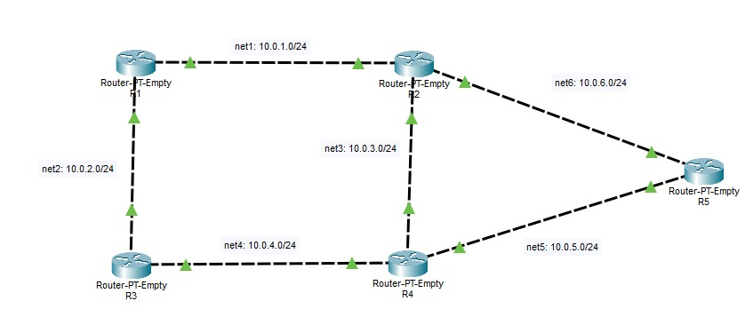
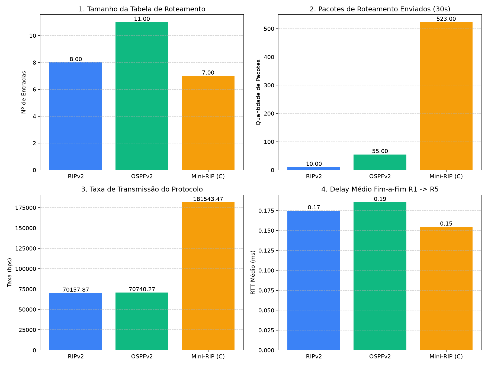

# 🌐 Análise Comparativa de Protocolos de Roteamento Dinâmico e Algoritmo Customizado

Projeto prático desenvolvido para o Grau A (GA) da disciplina de **Redes de Computadores**, com foco na emulação de topologias de Camada 3 (Rede), análise comparativa de protocolos de roteamento dinâmico em plataforma aberta (**FRRouting**) e proposta/implementação de um algoritmo de roteamento próprio.

---

## 📋 Índice

- [Visão Geral e Objetivos](#-visão-geral-e-objetivos)
- [Topologia de Rede (5 Roteadores)](#-topologia-de-rede-5-roteadores)
- [Plataforma de Roteamento (FRRouting)](#-plataforma-de-roteamento-frrouting)
- [Protocolos Avaliados](#-protocolos-avaliados)
  - [1. Protocolo A (ex: RIPv2 / Distance-Vector)](#1-protocolo-a)
  - [2. Protocolo B (ex: OSPFv2 / Link-State)](#2-protocolo-b)
  - [3. Algoritmo Próprio de Roteamento](#3-algoritmo-próprio-de-roteamento)
- [Estrutura do Repositório](#-estrutura-do-repositório)
- [Pré-requisitos e Execução](#-pré-requisitos-e-execução)
- [Guia de Configuração e Testes](#-guia-de-configuração-e-testes)
- [Métricas Coletadas e Geração de Gráficos](#-métricas-coletadas-e-geração-de-gráficos)
- [Resultados e Análise Comparativa](#-resultados-e-análise-comparativa)
- [Demonstração em Vídeo](#-demonstração-em-vídeo)
- [[EXTRA] Teste de Tolerância a Falhas e Convergência Dinâmica (Mini-RIP)](#extra-teste-de-tolerância-a-falhas-e-convergência-dinâmica-mini-rip)

---

## 🎯 Visão Geral e Objetivos

O projeto avalia o comportamento de diferentes soluções de roteamento IP diante de redundância e falhas de enlaces em uma topologia malhada com múltiplos caminhos.

O estudo compara três abordagens executadas de forma independente:

1. **Protocolo Padrão 1:** Vetor de Distâncias (RIPv2).
2. **Protocolo Padrão 2:** Estado de Enlace (OSPFv2).
3. **Algoritmo Próprio (Mini-RIP):** Solução customizada desenvolvida em C, baseada na lógica de vetor de distâncias (Distance-Vector). O protocolo opera via UDP (porta 5555), utiliza timers agressivos (1 segundo) para convergência ultrarrápida da malha e gerencia falhas injetando rotas dinâmicas diretamente na tabela (FIB) do kernel Linux dos contêineres Docker.

## 🏗 Topologia de Rede (5 Roteadores)

| Nó     | Interface / Rede           | Endereço IP                                        | Descrição / Conexão                                |
| :----- | :------------------------- | :------------------------------------------------- | :------------------------------------------------- |
| **R1** | `net1`<br>`net2`           | `10.0.1.10/24`<br>`10.0.2.10/24`                   | Enlace para R2<br>Enlace para R3                   |
| **R2** | `net1`<br>`net3`<br>`net6` | `10.0.1.20/24`<br>`10.0.3.20/24`<br>`10.0.6.20/24` | Enlace para R1<br>Enlace para R4<br>Enlace para R5 |
| **R3** | `net2`<br>`net4`           | `10.0.2.30/24`<br>`10.0.4.30/24`                   | Enlace para R1<br>Enlace para R4                   |
| **R4** | `net3`<br>`net4`<br>`net5` | `10.0.3.40/24`<br>`10.0.4.40/24`<br>`10.0.5.40/24` | Enlace para R2<br>Enlace para R3<br>Enlace para R5 |
| **R5** | `net5`<br>`net6`           | `10.0.5.50/24`<br>`10.0.6.50/24`                   | Enlace para R4<br>Enlace para R2                   |



## 🧰 Plataforma de Roteamento (FRRouting)

Para a emulação e controle da terceira camada (Rede) da topologia, foi selecionada a suíte de código aberto **[FRRouting (FRR)](https://frrouting.org/)**, executada sobre a imagem oficial `frrouting/frr:latest`.

### Origem e Relação com o Quagga

O FRRouting nasceu como um _fork_ direto do **Quagga** (que, por sua vez, derivou do projeto original **GNU Zebra**). Historicamente, o Quagga foi uma das ferramentas open source mais utilizadas para transformar máquinas Linux e BSD em roteadores dedicados. No entanto, com a evolução das redes modernas, o desenvolvimento do Quagga tornou-se lento, acumulando limitações de concorrência, suporte deficiente a novos padrões da IETF e problemas de desempenho sob alta carga.

Em resposta a isso, em 2017 a comunidade — liderada por grandes players da indústria e desenvolvedores centrais do próprio Quagga — fundou o FRR sob o guarda-chuva da _Linux Foundation_. O FRRouting reescreveu partes críticas do ecossistema, introduzindo uma arquitetura multithreaded mais eficiente, correções estruturais de segurança e suporte ativo aos padrões contemporâneos de roteamento IP.

### Por que o FRR foi escolhido para o projeto?

1. **Modernidade e Manutenção Ativa:** Enquanto o Quagga clássico se encontra em estado de estagnação e obsolescência para novos deployments, o FRRouting é a plataforma padrão da indústria atual em ambientes corporativos, datacenters e emulações acadêmicas.
2. **Arquitetura Modular:** O FRR opera através de múltiplos daemons desacoplados gerenciados pelo **`zebra`** (responsável por interagir diretamente com a FIB — _Forwarding Information Base_ — do kernel Linux). Protocolos como **RIPv2 (`ripd`)** e **OSPFv2 (`ospfd`)** rodam em processos independentes, permitindo habilitar, analisar e desligar cada protocolo de forma isolada, atendendo com precisão ao requisito de não execução simultânea.
3. **Gerenciamento Unificado (`vtysh`):** Disponibiliza uma CLI integrada padronizada com sintaxe _Cisco-like_ (IOS). Isso dispensa a necessidade de configurar arquivos de texto complexos para cada daemon em separado durante os testes interativos, permitindo alterar topologias, inspecionar tabelas e verificar adjacências em tempo real via comandos universais como `show ip route` e `show ip ospf neighbor`.
4. **Leveza e Integração com Docker:** A imagem oficial do FRRouting possui pegada reduzida em disco e baixo consumo de memória RAM, possibilitando instanciar facilmente os 5 nós roteadores em um único host sem sobrecarregar a máquina durante os testes de carga e convergência.

## 🔬 Protocolos Avaliados

Para atender ao requisito de comparar soluções com paradigmas distintos de roteamento e propor uma alternativa customizada, foram selecionados e avaliados:

---

### 1. Protocolo A: RIPv2 (Routing Information Protocol v2)

- **Classificação:** Protocolo de Roteamento Dinâmico Interno (IGP) do tipo **Vetor de Distâncias** (_Distance-Vector_).
- **Princípio de Funcionamento:**
  - Cada roteador conhece a topologia apenas sob a perspectiva de seus vizinhos imediatos ("roteamento por boato" / _routing by rumor_).
  - O anúncio das rotas é feito de forma **periódica a cada 30 segundos** por padrão, enviando a tabela de roteamento completa para o endereço multicast `224.0.0.9` via porta UDP `520`.
  - Diferente do RIPv1, o RIPv2 é _classless_ (envia a máscara de sub-rede junto com o anúncio), suportando VLSM e CIDR.
- **Métrica de Decisão:**
  - Utiliza exclusivamente a **contagem de saltos (_hop count_)**, desconsiderando largura de banda, latência ou saturação dos enlaces.
  - O limite máximo é de **15 saltos**; 16 saltos representam infinito/rede inalcançável.
- **Comportamento em Quedas e Convergência:**
  - Dependente de temporizadores rígidos (_Update_, _Invalid_, _Holddown_ e _Flush_).
  - Para evitar loops de roteamento em mudanças de topologia, implementa mecanismos como **Split Horizon** (não anunciar de volta uma rota pela interface de onde ela foi aprendida) e **Poison Reverse** (anunciar métrica 16 imediatamente ao detectar enlace caído).
  - **Limitação observada:** A convergência é lenta diante de falhas de enlaces intermediários, levando dezenas de segundos para que os temporizadores expirem e as rotas alternativas sejam consolidadas.

---

### 2. Protocolo B: OSPFv2 (Open Shortest Path First v2)

- **Classificação:** Protocolo de Roteamento Dinâmico Interno (IGP) do tipo **Estado de Enlace** (_Link-State_), fundamentado no algoritmo de **Dijkstra (Shortest Path First - SPF)**.
- **Princípio de Funcionamento:**
  - Ao contrário do RIP, todo roteador no OSPF constrói um **mapa idêntico e completo de toda a topologia** em sua base de dados local (_Link-State Database - LSDB_).
  - Descoberta e manutenção de vizinhança feitas via pacotes leves de **`Hello`** enviados a cada 10 segundos para os endereços multicast `224.0.0.5` (todos os roteadores OSPF) e `224.0.0.6` (roteadores designados DR/BDR) encapsulados diretamente sobre IP (protocolo número 89).
  - A troca de topologia ocorre via **LSAs (Link-State Advertisements)** disparados **sob demanda** (apenas quando há mudança de status de enlace) ou periodicamente em intervalos longos (a cada 30 minutos).
- **Métrica de Decisão:**
  - Utiliza o **Custo acumulado do caminho**, calculado inversamente proporcional à capacidade do link:
    $$\text{Custo} = \frac{\text{Largura de Banda de Referência (padrão 100 Mbps)}}{\text{Largura de Banda da Interface}}$$
  - Caminhos com menor custo total acumulado são eleitos e inseridos na FIB (_Forwarding Information Base_).
- **Comportamento em Quedas e Convergência:**
  - **Convergência quase instantânea (sub-segundo / 1 a 2s):** A perda de 4 pacotes _Hello_ consecutivos (Dead Interval = 40s padrão, ajustável) ou uma detecção direta de _carrier down_ dispara imediatamente um LSA de atualização para toda a rede.
  - Cada roteador recalcula de forma independente a árvore de caminhos mais curtos com o algoritmo de Dijkstra, sem o risco de loops típicos de vetor de distâncias.

---

### 3. Algoritmo Próprio de Roteamento (Mini-RIP Dinâmico em C)

Para propor uma solução customizada e avaliar os _trade-offs_ de desempenho em redes dinâmicas, foi desenvolvido do zero o **Mini-RIP Dinâmico**. Trata-se de um daemon leve escrito em C (compilado estaticamente para Alpine Linux) que opera na camada de aplicação via sockets UDP (porta `5555`).

- **Lógica de Funcionamento:**
  O algoritmo implementa o paradigma de Vetor de Distâncias (Bellman-Ford), mas descarta a complexidade de daemons tradicionais. Em sua inicialização, ele realiza a autodescoberta das interfaces ativas do container utilizando a biblioteca `<ifaddrs.h>` e passa a anunciar suas sub-redes diretamente no endereço de broadcast local. As rotas aprendidas são injetadas de forma direta na tabela de repasse (FIB) do kernel Linux através de chamadas do sistema (`ip route replace`).
- **Critérios para Seleção de Rotas:**
  Assim como o RIPv2, a métrica de custo é baseada em **contagem de saltos**, limitando a topologia ao infinito de 16 saltos.
- **Decisões de Projeto e Justificativas:**
  - **Convergência Agressiva:** O maior gargalo do RIPv2 padrão é sua lentidão de resposta a falhas. O Mini-RIP foi projetado com _Update Timers_ de 1 segundo e _Dead Timers_ de 3 segundos, atingindo tempos de convergência muito próximos aos do OSPF.
  - **Prevenção de Loops:** Para evitar loops de roteamento decorrentes da convergência rápida, o algoritmo implementa _Split Horizon_ nativo com _Poison Reverse_, garantindo que uma rota aprendida por uma interface não seja reanunciada nela mesma, exceto com custo infinito.
  - **Trade-off Consciente:** A decisão de aumentar a frequência de atualizações para 1 segundo resulta intencionalmente em um maior consumo de banda de controle e CPU, justificando-se como uma troca válida para cenários onde a resiliência imediata é mais crítica que o _overhead_ de pacotes.

---

### Estrutura do Repositório

Antes de iniciar os containers, certifique-se de que o arquivo `daemons` do FRRouting esteja dentro do diretório `config/` na raiz do projeto, exatamente conforme mapeado nos volumes do `docker-compose.yml`:

```text
TrabalhoGA/
├── config/
│   └── daemons                # Arquivo que habilita os protocolos no FRRouting
├── metricas/                  # Diretório de destino para os arquivos .txt coletados
├── docker-compose.yml         # Declaração da topologia, redes e endereços IP
├── Dockerfile                 # Receita para instalar dependências (tcpdump e gcc)
├── generate_charts.py         # Script Python para gerar o painel comparativo
├── mini_rip.c                 # Código fonte do algoritmo customizado de roteamento
├──.gitignore
└── README.md                  # Documentação do projeto

```

## ⚙️ Pré-requisitos e Execução

### Pré-requisitos do Ambiente

Para reproduzir a topologia e executar os testes, é necessário ter instalado na máquina host:

- **Docker Engine** (v24.0+ ou superior) e **Docker Compose** (v2.20+ ou superior).
- **No Windows:** Docker Desktop configurado com backend **WSL 2** (Ubuntu/Debian recomendado) e suporte a virtualização ativado na BIOS.
- **No Linux:** Docker instalado nativamente com permissão para execução de containers sem root (`docker` group) ou via `sudo`.
- **Ferramentas de diagnóstico de rede (no host ou acessíveis nos containers):**
  - `iproute2` (`ip route`, `ip link`, `ip addr`)
  - `traceroute` ou `mtr`
  - `ping`
  - `tcpdump` (para captura e contagem de pacotes de controle)
  - `iperf3` (para injeção e teste de vazão de tráfego)

---

### Execução do Ambiente com Docker

1. **Inicializar a malha de roteadores:**
   No diretório raiz do projeto (onde residem o `docker-compose.yml` e o arquivo `daemons`), suba os containers e as redes virtuais em segundo plano:

   ```bash
   docker compose up -d --build
   ```

2. **Verificar o status dos serviços:**
   Certifique-se de que os 5 nós (`R1` a `R5`) e as 6 redes foram instanciados corretamente:

   ```bash
   docker compose ps
   ```

3. **Acesso ao console de gerenciamento (FRRouting CLI):**
   Para interagir diretamente com a interface de linha de comando (`vtysh`) de qualquer um dos roteadores:

   ```bash
   docker exec -it <NOME_ROTEADOR> vtysh
   ```

   _(Exemplo para o roteador R1: `docker exec -it R1 vtysh`)_.

4. **Acesso ao shell do sistema operacional:**
   Caso seja necessário inspecionar interfaces de rede ou utilizar utilitários do Linux (`ip`, `ping`, `traceroute`):

   ```bash
   docker exec -it <NOME_ROTEADOR> sh
   ```

5. **Parar e limpar o ambiente:**
   Para interromper a execução dos containers e desmontar as redes virtuais:
   ```bash
   docker compose down
   ```

## 🛠️ Guia de Configuração e Testes

> **Regra do Trabalho:** Os protocolos e o algoritmo proposto **não** devem ser executados simultaneamente. Cada cenário deve ser configurado, medido e limpo antes de iniciar o próximo.

---

### 1. Cenário 1: Configuração e Avaliação do RIPv2

O RIPv2 é um protocolo de vetor de distâncias que anuncia suas rotas a cada 30 segundos usando multicast no endereço `224.0.0.9`.

#### Mapeamento de Anúncios das Sub-redes

| Roteador | Sub-redes a Anunciar                        |
| :------- | :------------------------------------------ |
| **R1**   | `10.0.1.0/24`, `10.0.2.0/24`                |
| **R2**   | `10.0.1.0/24`, `10.0.3.0/24`, `10.0.6.0/24` |
| **R3**   | `10.0.2.0/24`, `10.0.4.0/24`                |
| **R4**   | `10.0.3.0/24`, `10.0.4.0/24`, `10.0.5.0/24` |
| **R5**   | `10.0.5.0/24`, `10.0.6.0/24`                |

#### Configurar Roteadores

```bash
docker exec R1 vtysh -c "conf t" -c "router rip" -c "version 2" -c "network 10.0.1.0/24" -c "network 10.0.2.0/24" -c "end" -c "write memory"

docker exec R2 vtysh -c "conf t" -c "router rip" -c "version 2" -c "network 10.0.1.0/24" -c "network 10.0.3.0/24" -c "network 10.0.6.0/24" -c "end" -c "write memory"

docker exec R3 vtysh -c "conf t" -c "router rip" -c "version 2" -c "network 10.0.2.0/24" -c "network 10.0.4.0/24" -c "end" -c "write memory"

docker exec R4 vtysh -c "conf t" -c "router rip" -c "version 2" -c "network 10.0.3.0/24" -c "network 10.0.4.0/24" -c "network 10.0.5.0/24" -c "end" -c "write memory"

docker exec R5 vtysh -c "conf t" -c "router rip" -c "version 2" -c "network 10.0.5.0/24" -c "network 10.0.6.0/24" -c "end" -c "write memory"
```

#### Validação do RIPv2

```bash
docker exec -it R1 vtysh
show ip route
exit
```

```bash
docker exec -it R1 ping -c 4 10.0.5.50
docker exec -it R1 traceroute 10.0.5.50
```

#### Exportação de Métricas do RIPv2 para `.txt`

Com o protocolo convergido e ativo, salve os dados de latência, rota e tráfego na máquina host para alimentar os gráficos:

1. **Delay (Latência Fim-a-Fim):**

```bash
docker exec R1 ping -c 30 -i 0.2 10.0.5.50 > metricas/ping_rip.txt
```

2. **Tamanho da Tabela de Roteamento:**

```bash
docker exec R1 vtysh -c "show ip route" > metricas/rotas_rip.txt
```

3. **Quantidade de Pacotes e Taxa de Transmissão do Protocolo (Captura de 30s na porta UDP 520):**

```bash
docker exec R2 timeout 30 tcpdump -i any -nn -v "udp port 520" > metricas/pacotes_rip.txt 2>&1
```

#### Limpeza do RIPv2 (Obrigatório antes de iniciar o OSPF)

Para garantir que não haja conflito de rotas, é necessário remover o protocolo RIP de todos os roteadores antes de subir o cenário OSPF. Execute o comando correspondente ao seu sistema operacional:

**Para Linux / macOS / WSL (Bash):**

```bash
for r in R1 R2 R3 R4 R5; do
  docker exec $r vtysh -c "configure terminal" -c "no router rip" -c "exit" -c "write memory"
done
```

**Para Windows (Prompt de Comando / CMD):**

```cmd
FOR %r IN (R1 R2 R3 R4 R5) DO docker exec %r vtysh -c "configure terminal" -c "no router rip" -c "exit" -c "write memory"
```

**Para Windows (PowerShell):**

```powershell
foreach ($r in "R1","R2","R3","R4","R5") { docker exec $r vtysh -c "configure terminal" -c "no router rip" -c "exit" -c "write memory" }
```

---

### 2. Cenário 2: Configuração e Avaliação do OSPFv2

O OSPFv2 é um protocolo de estado de enlace baseado no algoritmo de Dijkstra (SPF), configurado em área de backbone única (`area 0`).

#### Configurar Roteadores

```bash
docker exec R1 vtysh -c "conf t" -c "router ospf" -c "network 10.0.1.0/24 area 0" -c "network 10.0.2.0/24 area 0" -c "end" -c "write mem"

docker exec R2 vtysh -c "conf t" -c "router ospf" -c "network 10.0.1.0/24 area 0" -c "network 10.0.3.0/24 area 0" -c "network 10.0.6.0/24 area 0" -c "end" -c "write mem"

docker exec R3 vtysh -c "conf t" -c "router ospf" -c "network 10.0.2.0/24 area 0" -c "network 10.0.4.0/24 area 0" -c "end" -c "write mem"

docker exec R4 vtysh -c "conf t" -c "router ospf" -c "network 10.0.3.0/24 area 0" -c "network 10.0.4.0/24 area 0" -c "network 10.0.5.0/24 area 0" -c "end" -c "write mem"

docker exec R5 vtysh -c "conf t" -c "router ospf" -c "network 10.0.5.0/24 area 0" -c "network 10.0.6.0/24 area 0" -c "end" -c "write mem"
```

```bash
docker exec -it R1 ping -c 4 10.0.5.50
docker exec -it R1 traceroute 10.0.5.50
```

#### Exportação de Métricas do OSPFv2 para `.txt`

Com as adjacências em estado `Full`, exporte os dados do OSPF para arquivos `.txt`:

1. **Delay (Latência Fim-a-Fim):**

```bash
docker exec R1 ping -c 30 -i 0.2 10.0.5.50 > metricas/ping_ospf.txt
```

2. **Tamanho da Tabela de Roteamento:**

```bash
docker exec R1 vtysh -c "show ip route" > metricas/rotas_ospf.txt
```

3. **Quantidade de Pacotes e Taxa de Transmissão do Protocolo (Captura de 30s no protocolo IP 89):**

```bash
docker exec R2 timeout 30 tcpdump -i any -nn -v "ip proto 89" > metricas/pacotes_ospf.txt 2>&1
```

#### Limpeza do OSPFv2 (Obrigatório antes de iniciar outro protocolo)

Para garantir que não haja conflito de rotas, é necessário remover o protocolo OSPF de todos os roteadores antes de subir o próximo cenário. Execute o comando correspondente ao seu sistema operacional:

**Para Linux / macOS / WSL (Bash):**

```bash
for r in R1 R2 R3 R4 R5; do
  docker exec $r vtysh -c "configure terminal" -c "no router ospf" -c "exit" -c "write memory"
done
```

**Para Windows (Prompt de Comando / CMD):**

```cmd
FOR %r IN (R1 R2 R3 R4 R5) DO docker exec %r vtysh -c "configure terminal" -c "no router ospf" -c "exit" -c "write memory"
```

**Para Windows (PowerShell):**

```powershell
foreach ($r in "R1","R2","R3","R4","R5") { docker exec $r vtysh -c "configure terminal" -c "no router ospf" -c "exit" -c "write memory" }
```

---

### 3. Cenário 3: Configuração e Avaliação do Algoritmo Próprio (Mini-RIP Dinâmico)

O Mini-RIP é um protocolo de vetor de distâncias escrito em C que descobre as redes ativas automaticamente. Ele roda fora do FRRouting, diretamente no sistema operacional do container, enviando atualizações a cada 1 segundo usando multicast/broadcast na porta UDP `5555`.

#### Mapeamento de Anúncios das Sub-redes (Descoberta Automática)

| Roteador | Sub-redes a Anunciar                        |
| :------- | :------------------------------------------ |
| **R1**   | `10.0.1.0/24`, `10.0.2.0/24`                |
| **R2**   | `10.0.1.0/24`, `10.0.3.0/24`, `10.0.6.0/24` |
| **R3**   | `10.0.2.0/24`, `10.0.4.0/24`                |
| **R4**   | `10.0.3.0/24`, `10.0.4.0/24`, `10.0.5.0/24` |
| **R5**   | `10.0.5.0/24`, `10.0.6.0/24`                |

#### Preparação: Compilação e Distribuição do Binário em C

Antes de executar, é necessário compilar o código fonte e copiá-lo para todos os nós. Execute os comandos no host:

```bash
docker cp mini_rip.c R1:/tmp/mini_rip.c
```

```bash
docker exec R1 gcc -O2 -static /tmp/mini_rip.c -o /tmp/mini_rip
```

```bash
docker cp R1:/tmp/mini_rip ./mini_rip
```

**Para Linux / macOS / WSL (Bash):**

```bash
for r in R1 R2 R3 R4 R5; do
  docker cp ./mini_rip $r:/usr/local/bin/mini_rip
  docker exec $r chmod +x /usr/local/bin/mini_rip
  docker exec -d $r /usr/local/bin/mini_rip
done
```

**Para Windows (Prompt de Comando / CMD):**

```cmd
FOR %r IN (R1 R2 R3 R4 R5) DO docker cp ./mini_rip %r:/usr/local/bin/mini_rip
FOR %r IN (R1 R2 R3 R4 R5) DO docker exec %r chmod +x /usr/local/bin/mini_rip
FOR %r IN (R1 R2 R3 R4 R5) DO docker exec -d %r /usr/local/bin/mini_rip
```

**Para Windows (PowerShell):**

```powershell
foreach ($r in "R1","R2","R3","R4","R5") { docker cp ./mini_rip $r:/usr/local/bin/mini_rip; docker exec $r chmod +x /usr/local/bin/mini_rip; docker exec -d$r /usr/local/bin/mini_rip }
```

#### Validação do Mini-RIP

Como o Mini-RIP manipula as rotas diretamente no kernel (e não dentro do `vtysh`), usamos o comando nativo `ip route` do Linux:

```bash
docker exec -it R1 ip route
```

```bash
docker exec -it R1 ping -c 4 10.0.5.50
docker exec -it R1 traceroute 10.0.5.50
```

#### Exportação de Métricas do Mini-RIP para `.txt`

Com o daemon convergido e rodando em background, salve os dados para os gráficos:

1. **Delay (Latência Fim-a-Fim):**

```bash
docker exec R1 ping -c 30 -i 0.2 10.0.5.50 > metricas/ping_proprio.txt
```

2. **Tamanho da Tabela de Roteamento (Lida direto do kernel):**

```bash
docker exec R1 ip route > metricas/rotas_proprio.txt
```

3. **Quantidade de Pacotes e Taxa de Transmissão do Protocolo (Captura de 30s na porta UDP 5555):**

```bash
docker exec R2 timeout 30 tcpdump -i any -nn -v "udp port 5555" > metricas/pacotes_proprio.txt 2>&1
```

#### Limpeza do Mini-RIP (Encerramento do Cenário 3)

Como o protocolo roda como um processo solto no Linux, basta "matar" o processo em todos os roteadores para resetar o cenário. Execute o comando correspondente ao seu sistema operacional:

**Para Linux / macOS / WSL (Bash):**

```bash
for r in R1 R2 R3 R4 R5; do
  docker exec $r killall mini_rip 2>/dev/null
done
```

**Para Windows (Prompt de Comando / CMD):**

```cmd
FOR %r IN (R1 R2 R3 R4 R5) DO docker exec %r killall mini_rip 2>nul
```

**Para Windows (PowerShell):**

```powershell
foreach ($r in "R1","R2","R3","R4","R5") { docker exec $r killall mini_rip 2>$null }
```

## 📊 Métricas Coletadas e Geração de Gráficos

Para avaliar quantitativamente os protocolos e cumprir os requisitos da disciplina, as métricas exportadas para os arquivos `.txt` cobrem quatro pilares fundamentais:

1. **Tamanho da Tabela de Roteamento (`rotas_*.txt`):** Contagem do número total de entradas ativas instaladas na FIB de cada roteador.
2. **Quantidade de Pacotes de Roteamento Enviados (`pacotes_*.txt`):** Total de pacotes de controle trafegados no nó central (`R2`) durante uma janela fixa de 30 segundos.
3. **Taxa de Transmissão do Protocolo (`pacotes_*.txt`):** Soma do tamanho em bytes (`length`) de todos os pacotes de controle capturados, dividida pelo tempo de amostragem (30s), resultando na taxa de ocupação de banda em bits por segundo (bps).
4. **Delay Fim-a-Fim (`ping_*.txt`):** Tempo de ida e volta (_Round-Trip Time_ - RTT em ms) medido através de 30 disparos consecutivos de pacotes ICMP Echo entre os extremos da rede (`R1` e `R5`).

### Como gerar os Gráficos Comparativos

Um script Python (`generate_charts.py`) acompanha o repositório para processar automaticamente os dados brutos e gerar o painel comparativo.

Para rodar o script sem causar conflitos nas bibliotecas da máquina host, recomenda-se o uso de um ambiente virtual:

**1. Criar e ativar o ambiente virtual:**

- Em ambientes **Linux/Mac**:
  ```bash
  python3 -m venv venv
  source venv/bin/activate
  ```
- Em ambientes **Windows**:
  ```powershell
  python -m venv venv
  .\venv\Scripts\activate
  ```

**2. Instalar dependências e executar o script:**

```bash
pip install matplotlib
python generate_charts.py
```

O script criará a imagem `metricas_comparativas.png` no diretório atual. Após a execução, você pode sair do ambiente virtual digitando `deactivate` no terminal.

## 📈 Resultados e Análise Comparativa



**Análise dos Resultados:**

- **Latência e Tabela de Rotas:** Os três protocolos estabilizaram a rede corretamente, apresentando latências residuais na comunicação entre as extremidades da malha. O Mini-RIP (C) obteve o menor atraso fim-a-fim, com 0.15 ms, comparativamente aos 0.17 ms do RIPv2 e 0.19 ms do OSPFv2. Adicionalmente, o algoritmo em C apresentou a tabela de roteamento mais enxuta, com 7 entradas, face às 8 do RIPv2 e 11 do OSPFv2.

- **Overhead e Taxa de Transmissão:** O Mini-RIP em C gera um volume substancialmente maior de tráfego de controle, emitindo 523 pacotes de roteamento num intervalo de 30 segundos, em forte contraste com os 55 pacotes do OSPFv2 e os 10 pacotes do RIPv2. Este comportamento reflete-se na taxa de transmissão, em que o Mini-RIP consome 181543.47 bps, superando largamente os 70740.27 bps do OSPFv2 e os 70157.87 bps do RIPv2. Este é o custo arquitetural escolhido deliberadamente para garantir temporizadores agressivos de 1 segundo (Update Timer) e atingir uma convergência ultrarrápida perante falhas físicas.

## 🎥 Demonstração em Vídeo

Para visualizar a execução prática deste laboratório, incluindo a inicialização da topologia Docker, a configuração dos protocolos e o teste em tempo real de tolerância a falhas provando a convergência do Mini-RIP no kernel do Linux, assista ao vídeo de demonstração.

🔗 **[Clique aqui para assistir à gravação da demonstração no SharePoint](https://asavbrm-my.sharepoint.com/:v:/g/personal/cassolli_edu_unisinos_br/IQBgSqQG12OlTKsgGDF-fEgLAaofdttuIAlimQixzobiO-Q?e=YdASiJ&nav=eyJyZWZlcnJhbEluZm8iOnsicmVmZXJyYWxBcHAiOiJTdHJlYW1XZWJBcHAiLCJyZWZlcnJhbFZpZXciOiJTaGFyZURpYWxvZy1MaW5rIiwicmVmZXJyYWxBcHBQbGF0Zm9ybSI6IldlYiIsInJlZmVycmFsTW9kZSI6InZpZXcifX0%3D)**

## [EXTRA] Teste de Tolerância a Falhas e Convergência Dinâmica (Mini-RIP)

Para comprovar a autonomia do protocolo de roteamento desenvolvido em C (Mini-RIP), este teste demonstra a capacidade da malha de se recuperar automaticamente diante da queda abrupta de um nó central. O objetivo é manter a comunicação entre as extremidades (R1 e R5) sem qualquer intervenção manual.

**1. Verificação da Rota Inicial**

Com todos os contêineres e processos do `mini_rip` ativos, verificamos a tabela de roteamento injetada no kernel do R1:

```bash
docker exec R1 ip route
```

_Atenção a este detalhe:_ Observe o endereço IP após a palavra `via` na linha referente à rede do R5 (`10.0.5.0/24`). Como o Mini-RIP descobre as rotas dinamicamente, o caminho principal pode variar. Identifique por onde os pacotes estão passando:

- Se a rota apontar `via 10.0.1.20`, o tráfego está passando pelo **R2**.
- Se a rota apontar `via 10.0.2.30`, o tráfego está passando pelo **R3**.

Anote qual roteador está sendo utilizado no momento, pois ele será o alvo da nossa simulação de falha.

**2. Monitoramento de Conectividade**

Iniciamos o envio contínuo de pacotes ICMP do R1 para o R5, a fim de monitorar a latência e a disponibilidade em tempo real:

```bash
docker exec R1 ping 10.0.5.50
```

**3. Simulação da Queda do Roteador (Desastre)**

Em um segundo terminal, simulamos uma falha crítica de hardware ou queda de energia desligando abruptamente o roteador por onde o tráfego estava fluindo (conforme identificado no Passo 1):

```bash
# Se a rota passava pelo R2, execute:
docker stop R2

# OU se a rota passava pelo R3, execute:
docker stop R3
```

_Comportamento esperado:_ O tráfego do ping no primeiro terminal será interrompido momentaneamente, pois os pacotes começarão a ser enviados para um "buraco negro" (o roteador que acabou de cair).

**4. Recálculo e Auto-Recuperação**

Após o estouro do _Dead Timer_ agressivo programado no algoritmo em C (ausência dos anúncios UDP na porta 5555), o Mini-RIP do R1 expurga a rota corrompida e recalcula a topologia, injetando o caminho alternativo na FIB do Linux.

O ping no primeiro terminal voltará a responder automaticamente. Consultando a tabela novamente:

```bash
docker exec R1 ip route
```

_Comportamento esperado:_ A rede `10.0.5.0/24` e as demais rotas afetadas terão sido transferidas dinamicamente para o roteador sobrevivente. Se o R2 caiu, a tabela passará a apontar via R3 (`10.0.2.30`). Se o R3 caiu, a nova rota apontará via R2 (`10.0.1.20`).
